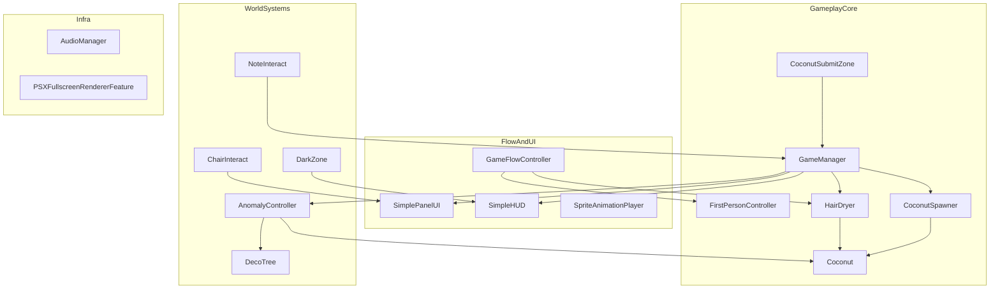

# CoCoBlow

第一人称 3D「吹椰子 → 提交 → 双轨升级 → 读纸条 → 异常 escalation」的 Jam 向垂直切片：用锥形风力物理驱动资源循环，再用升级反哺生产与叙事。本仓同时作为 **FPS 交互 + 物理风力 + URP 后处理 + 流程门控** 的作品集展示。

队伍：404 Sleep Not Found　|　[椰酱 Game Jam 2026 活动页](https://game.icon.cn/events/scnucj2026)　|　展示 fork：[linkbgame/CoCoBlow](https://github.com/linkbgame/CoCoBlow)　|　团队原仓：[Retr0-Jaxon/CoCoBlow](https://github.com/Retr0-Jaxon/CoCoBlow)

主场景：`Assets/Scenes/LRB_Scene.unity`（Build Settings 唯一启用场景）

---

## 技术栈


| 层 | 实际使用 |
|----|----------|
| 引擎 / 渲染 | Unity **2022.3.62f3c1**（`ProjectSettings/ProjectVersion.txt`），**URP 14.0.12** |
| 输入 | **Input System 1.14.0**（`Keyboard.current` / `Mouse.current`，非旧 Input Manager） |
| UI | uGUI + **TextMeshPro 3.0.7** |
| 玩法代码 | 自写 C#（约 27 个业务脚本）；`manifest.json` 里的 Timeline / Visual Scripting **未驱动核心循环** |
| 音频 | 自研 `AudioManager` + `AudioMixer.mixer` |
| 开发工具（可选，非运行时依赖） | Cursor IDE 包、`com.coplaydev.unity-mcp` |

---

## 核心特性

技术含量集中在风力物理、生产上限、双轨升级与异常升级，而不是功能清单：

1. **锥形风力，而不是一律 `AddForce`**  
   `HairDryer` 在 `FixedUpdate` 用 `Physics.OverlapSphere` 粗筛，再按喷嘴方向做夹角 / 距离衰减。挂在树上的椰子走 `Coconut.ApplyWindForce`：风力按时间累积，超过阈值（脚本默认 45）才 `ReleaseFromTree`；地上刚体才施加持续力。挂树阶段另有摇晃视觉（`wobbleFrequency` 等），不改刚体。

2. **生成上限只统计「还挂在树上的」椰子**  
   `CoconutSpawner.maxActiveCoconuts` 通过 `CountAttachedCoconuts()` 只计 `IsAttached`。吹落到地、尚未进提交区的椰子不占名额，避免「地上一堆就停产」。

3. **双轨升级数据驱动**  
   `GameManager` 用两份 `UpgradeStage[]` 分开吹风机（风力 / 射程 / 锥角，可 `SwapHairDryer` 换 Prefab）和椰子树（冷却、挂树上限、`spawnExtraTree` 再 `Instantiate` 第二棵并 `RegisterSpawner`）。消耗默认按 GDD（5/12/20 与 8/15/25）；场景 Inspector 可能是联调测试值 1/2/3，**以当前场景为准**。

4. **全屏节点科技树 UI（不是「点亮椰子」）**  
   `SimplePanelUI` + `UpgradeNodeButton` + `UpgradeSubMenuLayout` + `UpgradeLayoutPreset`，按 1920×1080 参考布局切子菜单。GDD 的「每解锁一项点亮一颗椰子」明确未做。

5. **升级驱动的渐进异常**  
   `GameManager.OnHairDryerUpgradeEvent` 直接调 `AnomalyController.OnHairDryerUpgraded`。异常只加不减：落地闪 Point Light、落地后 `WaitForFixedUpdate` 再朝玩家水平冲、播 `anomaly` 音、可选 `DecoTree.TriggerRotation` 抖动（`enableAnomalyGlitch`）。落地判定在 `Coconut.OnCollisionEnter`：离树后第一次法线偏上的地面碰撞，每颗只触发一次。

6. **封面 / 结局流程门控**  
   `GameFlowController.IsBlockingGameplay` + `Time.timeScale = 0`。`FirstPersonController` 与 `HairDryer` 统一停移动 / 吹风；点「开始」才 `PickUp` 并播 `atmosphere`。读完最后一张纸条 → `SimplePanelUI.ShowEndingPanel` → `SpriteAnimationPlayer` 序列帧 → `LoadScene` 回封面。

7. **黑暗区：包围盒进出，而不是只靠 Trigger 回调**  
   `DarkZone` 每帧用 `CharacterController` 包围盒与区域 `bounds.Intersects` 判断安全区，处理反复进出；超时禁用 CharacterController 后传送回 `respawnPoint`。`SimpleHUD` 全屏纯黑 overlay，alpha 从 0.7 插到 1。

8. **程序化风力范围可视化 + 编辑器一键生成**  
   `HairDryerRangeVisual` 按 `windRange` / `windAngle` 生成 cone mesh，吹风时淡入淡出（不做粒子）。菜单 `CoCoBlow/Create Hair Dryer Range Visual Prefab`（`HairDryerRangeVisualBuilder`）生成材质与 Prefab。URP 全屏 PSX 滤镜（`PSXFullscreenRendererFeature` + `PSXFullscreen.shader`）已实现；**是否启用以当前 URP Asset 为准**（仓库历史中有过 revert）。

---

## 架构设计

Jam 规模下选择 **单例枢纽 + 直接调用**，不引入事件总线或状态机框架。模块按「流程 / 玩法核 / 世界系统 / 基础设施」切开。



### 目录（业务脚本）

```
Assets/Managers/          GameManager.cs, AudioManager.cs
Assets/Scripts/
  FirstPersonController.cs, HairDryer.cs, HairDryerRangeVisual.cs
  KeepInsideZone.cs       早期出界方案；黑暗视野不依赖它
  Coconut/                Coconut, CoconutSpawner, CoconutSpawnPoint, CoconutSubmitZone, DecoTree
  Environment/            AnomalyController, DarkZone
  Interact/               IInteractable, ChairInteract, NoteInteract
  Rendering/              PSXFullscreenRendererFeature
  UI/                     GameFlowController, SimpleHUD, SimplePanelUI,
                          SpriteAnimationPlayer, UpgradeNodeButton,
                          UpgradeSubMenuLayout, UpgradeLayoutPreset
Assets/Editor/            HairDryerRangeVisualBuilder.cs
```

### 关键设计决策

| 决策 | 选了什么 | 权衡 |
|------|----------|------|
| 风力模型 | 锥角 `windAngle` + 球体重叠 + 挂树累积阈值 | 不是流体、也不是 GDD「半径米」场（MVP 明确不重写）。Jam 期 Inspector / Gizmos 可调，手感稳定。 |
| 全局状态 | `GameManager`、`GameFlowController`、`AnomalyController`、`AudioManager` 单例 | 少脚本、调用路径一眼能跟。扩展联机或热重载要拆成服务定位 / 事件。`AudioManager` 额外 `DontDestroyOnLoad`（见踩坑）。 |
| 数值放哪 | `UpgradeStage` 代码默认走 GDD；场景可覆盖 | 手改 `LRB_Scene.unity` YAML 再 `SaveScene` 会把升级表打回旧值。发版前在 Inspector 改消耗即可，不必改代码。 |

### 用了哪些模式、用在哪、为什么

- **单例**：上述四个类型。Jam 周期内避免到处 `FindObjectOfType` 传引用；Awake 里仍保留查找兜底。
- **策略式交互（接口）**：`IInteractable`（`CanInteract` / `Interact` / `GetHintText`）。`ChairInteract` 开升级面板，`NoteInteract` 读 `GameManager` 已解锁纸条。`GetHintText` 固定返回空——E 键提示文案本轮不做。射线在 `FirstPersonController.FindInteractionTargets` 里按 **纸条 → 王座 → 未手持吹风机** 优先级取具体类型，不是泛型 `GetComponent<IInteractable>()`。
- **没有事件总线**：吹风机升级到异常是 `GameManager` 直接调 `AnomalyController.Instance`。观察者框架的解耦收益，盖不过多一个间接层的调试成本。
- **没有状态机框架**：封面 / 游玩 / 面板 / 结局靠 `IsBlockingGameplay` 与 `SimplePanelUI.IsOpen` 布尔门控，外加 `timeScale`。足够覆盖垂直切片，Escape 暂停仍是 TODO。
- **没有对象池**：椰子 `Instantiate` / 提交后 `Destroy`。场上同时存活数量由挂树上限约束（开局 2，强化后每棵最多 4），池化收益不明显。

玩家循环（实现口径）：

```
封面 cover.png（timeScale=0，不锁鼠标，不播 atmosphere）
  → 开始：持吹风机，进第一人称
  → CoconutSpawner 按挂点生成（默认 5 点）
  → HairDryer 吹落 → CoconutSubmitZone 加分并 PlayAudio3D("watered")
  → ChairInteract 开双轨科技树
  → 吹强化 1/2/3：异常 1/2/3（+ 可选异常 4）并解锁纸条
  → 树强化 1/2/3：上限 4 → 冷却 1.5s → 第二棵树
  → 出安全区：黑暗 overlay + 倒计时，超时回出生点
  → 读最后一张纸条：序列帧结局 → 点击 LoadScene 回封面
```

---

## 演示

<!-- 建议素材（请自行替换占位）：
  1. 循环 GIF：封面点开始 → 吹落椰子（注意树上摇晃）→ 吹进提交区 → 王座打开科技树 → 升级后异常落地闪光/冲向玩家
  2. 截图：Assets/Images/cover.png（封面）
  3. 截图：全屏双轨科技树（Assets/Images/UpgradeUI/）
  4. 截图或短视频：黑暗区 overlay + HUD 倒计时
  5. 短视频：Assets/Images/ending/ 序列帧结局（SpriteAnimationPlayer，24fps）
  6. 外链：https://game.icon.cn/events/scnucj2026
-->

| 建议位置 | 放什么 |
|----------|--------|
| 循环演示 | `docs/demo-loop.gif`（封面 → 吹落 → 提交 → 升级 → 异常） |
| 封面 | `Assets/Images/cover.png` |
| 科技树 | `Assets/Images/UpgradeUI/` 下的布局图 |
| 结局 | `Assets/Images/ending/1.png`–`15.png` 或导出短片 |

---

## 运行方式

### 环境

- Unity **2022.3.62f3c1**（中国版 hash 与 `ProjectVersion.txt` 一致即可；换小版本可能打脚本）。
- Git 能拉 HTTPS 包：`com.unity.inputsystem`、`com.unity.render-pipelines.universal`，以及 manifest 里的 Cursor / MCP Git URL（仅编辑器）。

### 打开与运行

1. 克隆仓库，用 Unity Hub **Add** 项目根目录（含 `Assets/`、`Packages/`、`ProjectSettings/`）。
2. 等 Package Manager 解析完成、脚本编译通过。
3. 打开 **`Assets/Scenes/LRB_Scene.unity`**，点 Play。  
   `EditorBuildSettings` 已只勾该场景；`SampleScene` / `ParaNoite` / `AreaDetectSample` / `LRB_Scene 1` 是原型或测试场景，不进 Build。
4. 打包：File → Build Settings → 确认场景列表后 Build。RangeVisual 曾出现「编辑器与 Build 不一致」，改过后再打一包对照（见下节）。

### 操作

| 输入 | 行为 |
|------|------|
| WASD | 移动（`CharacterController`） |
| 鼠标 | 视角；左键吹风（手持时） |
| E | 交互王座 / 已解锁纸条；拾取地上的吹风机 |
| G | 放下手持吹风机（向下射线找地面） |
| 空格 | 跳跃（MVP 明确保留） |
| Esc | 仅解锁光标，**没有完整暂停菜单**（脚本内 TODO） |

调试：`GameManager` 勾选 `enableCheatMode` 后按 `O` 一次加 6 个椰子。

`.gitignore` 按官方 Unity 模板忽略 `Library/`、`Logs/`、`UserSettings/`、`*.csproj` / `*.sln`。场景 / Prefab 走 Unity YAML Merge（`.gitattributes` + `Tools/UnityYAMLMergeWrapper.ps1`）。

---

## 性能优化 / 踩坑记录

下列都是开发中真实遇到、并在代码或 [Docs/MVP闭环修改计划.md](./Docs/MVP闭环修改计划.md) 里留下解法的问题。

**风力范围可视化：编辑器正常、Build 不对**  
`HairDryerRangeVisual` 运行时生成 mesh + `MaterialPropertyBlock`。曾出现编辑器与真机包效果不一致（commit `c06c03d`）。根因在 URP 透明材质 / 运行时 mesh 在 Build 管线下的差异，而不是「没挂脚本」。对策：用编辑器菜单生成稳定 Prefab/材质，并在 Build 包里对照吹风淡入。

**提交区 Trigger 顶面埋地，进池不加分**  
`CoconutSubmitZone` 只在 `OnTriggerEnter` 里 `MarkSubmitted` + `AddCoconut` 然后 `Destroy`。Collider 顶面埋进地面时 Trigger 打不到。把提交池 BoxCollider 抬到地面以上后恢复。

**刚吹落又被同一阵风吸飞**  
`Coconut.ReleaseFromTree` 后设 `windIgnoreUntilTime`（`windIgnoreDurationAfterRelease`，默认 0.3s）。`HairDryer` 对 `!CanReceiveWindForce` 的椰子跳过施力。

**异常 2 的冲量被落地弹跳盖掉**  
先等一帧 `WaitForFixedUpdate`，再设水平 `velocity`、清角速度，避免落地反弹覆盖冲向玩家的速度。

**树 Scale 0.2 后，挂树椰子视觉缩小**  
`AttachToTree` 用父物体 `lossyScale` 做 `ApplyCompensatedLocalScale`，掉落后世界大小与树上一致。树实例 Scale 0.2、`TinyCoconut` 约 0.306（相对身高 2 的 CharacterController）。

**场景 YAML 合并把升级表打回旧值**  
多人改 `LRB_Scene.unity` 时，手改 YAML 再在编辑器 Save 会覆盖升级消耗。工程侧用 Unity Smart Merge；数值改动优先走 Inspector。

**`AudioManager` 的 `DontDestroyOnLoad`**  
单例 `PatternSingleton()` 会跨场景存活。MVP 选择不改这个行为，改为封面 `StopAllAudio`、点开始再播 `atmosphere`，结局 `LoadScene` 回标题时靠停 loop 音规避「两层 BGM」。

**性能口径（诚实）**  
- 椰子生命周期是 `Instantiate` / `Destroy`，没有对象池。  
- `HairDryer.FixedUpdate` 每次吹风 `OverlapSphere` 全层检测，无 `LayerMask`、会分配 `Collider[]`。Jam 场上刚体数量可控，可接受；量产应改 NonAlloc + 椰子层。  
- `AnomalyController` 触发异常 4 时 `FindObjectsOfType<DecoTree>()`，只在升级瞬间跑一次。

---

## 未来计划 / 已知局限

来自 MVP「本轮明确不做」与代码 TODO，**不要当成已实现**：

- 纸条解密、运输、种植；科技树「点亮椰子」；把风力改成半径米物理。
- 去掉跳跃、E 键世界空间提示文案、改挂点数量（保持 5）。
- `FirstPersonController`：Escape 暂停光标逻辑未完成；落地 `verticalVelocity = -2f` 旁有待复核注释。
- 无存档、无联机、无正式暂停菜单。
- `KeepInsideZone` 是早期出界传送方案，当前黑暗体验走 `DarkZone`，两者并行存在。

玩法落地对照（计划 vs 实现）见 [Docs/MVP闭环修改计划.md](./Docs/MVP闭环修改计划.md)。谁改了哪条脚本见下方附录，或 [Docs/团队贡献.md](./Docs/团队贡献.md)。

---

## 附录：团队分工与贡献追溯

以下为原 README 全文，未改写。口径仍是 Git `main` 非 merge 提交 + 美术云盘对照，供路演 / 答辩追溯。

# CoCoBlow — 项目说明与团队分工

> 队伍：404 Sleep Not Found  
> 作品：[CoCoBlow](https://game.icon.cn/events/scnucj2026)（椰酱 Game Jam 2026）  
> 本仓库（面试展示 fork）：[linkbgame/CoCoBlow](https://github.com/linkbgame/CoCoBlow)  
> 团队原仓：[Retr0-Jaxon/CoCoBlow](https://github.com/Retr0-Jaxon/CoCoBlow)  
> 引擎：Unity 2022.3.62f3c1 / URP  
> 主场景：`Assets/Scenes/LRB_Scene.unity`  
> 整理日期：2026-10-18  
> 口径：程序职责基于 Git `main` 分支非 merge 提交；美术源资产对照飞书云盘 `art` 目录（2026-10-18）与 Unity `Assets/` 入库路径归纳

本文与 [Docs/团队贡献.md](./Docs/团队贡献.md) 内容一致，回答「谁做了什么」，便于路演 / 答辩追溯。玩法落地细节见 [Docs/MVP闭环修改计划.md](./Docs/MVP闭环修改计划.md)。美术源目录与工程对照见下方 **§2.1**。

---

## 1. 统计方法与局限

| 项 | 说明 |
|----|------|
| 统计分支 | **`main`**，`--no-merges` |
| 非 merge 提交 | 约 96 次 |
| 作者归并 | `linkbgame` 与 `阿彬` 邮箱均为 `llrbking0@gmail.com`，合并为 **linkbgame**；`阿彬` 仅 stash / 测试类记录，不单列 |
| 辅助证据 | `git log --follow` 脚本首创建者、`git show` 大提交文件列表、本文对照的 MVP 闭环文档 |

**局限：**

- Unity 场景 YAML（尤其 `LRB_Scene.unity`）多人反复改同一文件，无法精确到「某棵树是谁摆的」。
- Merge 集成提交集中在 `Retr0_Jaxon`，不等于该人独自实现被合入的功能。
- 仓库几乎没有 `Co-authored-by`；并列贡献按提交说明与文件创建者推断。
- `--all` 会把 fork / `feature/lrb` / 备份分支重复计入，**不以 `--all` 作为人数依据**。

Git 昵称与真实姓名若需对外展示，请在文末「待核对」处补全。

---

## 2. 一句话分工

| Git 作者 | main 非 merge 提交 | 一句话 |
|----------|-------------------|--------|
| ParaNoite | 33 | 音频系统、地编氛围、纸条文案、结局演出、异常 4 |
| Retr0_Jaxon | 31 | 项目初始化、FPS/吹风机原型、王座科技树 v1、仓库集成、渲染/打包兜底 |
| linkbgame | 30 | 椰子提交循环、LRB 场景主程、升级 UI 双轨科技树、黑暗区初版 |
| Gogol | 2 | Jam 截止前 MVP 闭环联调（批次 A–F）与对照文档 |
| 美术同学（无 Git 记录） | — | 飞书云盘 `art`：场景/道具模型、封面、科技树 UI、结局序列帧等源资产 |

提交次数 **不等于** 贡献权重。Gogol 两次提交覆盖封面、异常 1–3、第二棵树钩子、结局回标题等横切改动。美术同学的产出在 Git 外（云盘），入库与挂接由程序完成，见 §2.1。

---

## 2.1 美术资产与云盘 art（源文件）

云盘 `art` 是美术同学的**开发源目录**；本仓库 `Assets/` 是 Jam 集成后的**运行版本**。两边不必一一对应：部分云盘子文件夹尚未入库，部分工程资源已经过程序改名或拆分。

- **定位**：飞书分享文件夹 [art](https://jcnwab5wfwu2.feishu.cn/drive/folder/U0oqfal5fla3ZUdlmhLcQ0j4ns3)（打开需团队权限；面试可向队伍索取）。
- **整理日期**：2026-10-18（按云盘一级目录截图 + 当前 `main` 的 `Assets/`）。
- **使用方式**：先在云盘看源文件命名与版本，再到下表 Unity 路径打开 Prefab / 贴图；主场景为 `Assets/Scenes/LRB_Scene.unity`。

### 云盘一级目录

```
art/
  basket/              提交篮 / 收集容器源文件
  blower/              吹风机模型与贴图
  coconut tree/        椰子树
  cover/               封面
  ending/              结局序列帧
  icon/                图标 / HUD 用椰子图
  one coconut/         可交互小椰子
  paper/               纸条
  room/                房间场景模型
  tech tree/           升级科技树 UI
  throne/              王座
  未命名文件夹/        未整理或未入库
  说明&日志&留言板     美术说明文档（仅云盘）
```

### 云盘 ↔ Unity 对照

| 云盘 `art` | 资产类型 | Unity 工程路径（已入库） | 程序侧挂接（Git） |
|------------|----------|--------------------------|-------------------|
| `blower/` | 吹风机模型 / 贴图 | `Assets/Models/blower/`（`blower_01s.fbx`、`blower_02l.fbx` 及贴图）；`Assets/Prefabs/HairDryer*.prefab` | linkbgame 导入并挂升级链 |
| `coconut tree/` | 椰子树 | `Assets/Models/coconut tree_03.fbx`；`Assets/Prefabs/Deco_tree.prefab` | linkbgame 生产树；ParaNoite Deco 树 |
| `one coconut/` | 小椰子 | `Assets/Models/tiny cocona.fbx`、`cocona.png`；`Assets/Prefabs/TinyCoconut.prefab` | linkbgame 椰子链 |
| `room/` | 房间场景 | `Assets/Models/room/`（`room.fbx`、管道 / 水面贴图） | linkbgame 搭 LRB 场景 |
| `throne/` | 王座 | `Assets/Models/throne/`；`Assets/Prefabs/throne.prefab` | Retr0_Jaxon / linkbgame 王座交互 |
| `paper/` | 纸条模型 | `Assets/Models/paper/`（`paper.fbx`、`paper.png`） | linkbgame 交互；ParaNoite 文案 |
| `cover/` | 封面图 | `Assets/Images/cover.png` | Gogol 封面流程接入 |
| `ending/` | 结局序列帧 | `Assets/Images/ending/`（`1.png`–`15.png`） | ParaNoite `SpriteAnimationPlayer` |
| `tech tree/` | 科技树 UI 图 | `Assets/Images/UpgradeUI/`（`tech tree.png`、chosen 布局图） | linkbgame 全屏双轨科技树 |
| `icon/` | HUD / 图标 | `Assets/Images/ccn amount.png`；`Assets/Models/ccn.png` | HUD 椰子计数 |
| `basket/` | 提交篮源文件 | 未见独立同名模型；提交区逻辑在 `CoconutSubmitZone` / `Assets/prefabsave/` | linkbgame 提交循环 |
| `未命名文件夹/` | 未整理 | 仓库中无对应目录 | — |
| `说明&日志&留言板` | 美术文档 | 仅云盘，未进 Git | — |

**局限：** Git 无法统计美术同学的提交次数；上表按云盘目录名与工程文件名对应，不表示「某张贴图的每一个像素版本」都已同步。以云盘为源、以 `main` 上 `Assets/` 为可运行版本。

---

## 3. 协作时间线

```
SampleScene 原型          Retr0_Jaxon：FPS、吹风机、王座升级 v1
        │
        ├─ ParaNoite/audio   ParaNoite：AudioManager、Mixer、音效资源
        │
        └─ feature/lrb       linkbgame：椰子循环、LRB 场景、双轨科技树、DarkZone
                │
                ▼
        dev 联调收口
                ├─ Gogol：MVP 闭环批次 A–F（封面 / 生产升级 / 异常 1–3 / 结局回标题）
                ├─ ParaNoite：地编、文案、HUD、结局动画、异常 4
                └─ Retr0_Jaxon：合并、PSX/URP、RangeVisual Build 修复
                │
                ▼
              main
```

---

## 4. 成员职责

### 4.1 Retr0_Jaxon — 原型架构 / 主仓库集成

**角色：** 仓库维护者；第一人称与吹风机原型；早期王座科技树；合并音频线与 LRB 线；渲染与打包问题兜底。

| 领域 | 内容 | 关键提交 |
|------|------|----------|
| 项目初始化 | First Commit；SampleScene 与编辑器搭建脚本 | `a9c9544`、`7cf9d06` |
| 核心玩法框架 | 创建 `FirstPersonController.cs`、`HairDryer.cs`；重构王座科技树与装备升级（GameManager / SimplePanelUI / 吹风机 Prefab） | `67fb440` |
| 工程协作 | Unity Smart Merge（`.gitattributes`、`Tools/UnityYAMLMergeWrapper.ps1`）；合入 ParaNoite 音频线；Unity f1→f3 | `f38273d`、`9c826e8`、`1f0b3bf` |
| 视觉 / Build | PSX 全屏滤镜（后有部分 revert）；RangeVisual 编辑器与 Build 包效果不一致修复；双面材质、URP Renderer | `469495e`、`73f1c9f`、`c06c03d`、`6a340f8` |

**主要文件：**

- `Assets/Scripts/FirstPersonController.cs`（创建）
- `Assets/Scripts/HairDryer.cs`（创建）
- `Assets/Managers/GameManager.cs`（早期大幅重构）
- `Assets/Scripts/Rendering/PSXFullscreenRendererFeature.cs`
- `Assets/Shaders/PSXFullscreen.shader`

---

### 4.2 linkbgame — LRB 场景主程 / 玩法与 UI

**角色：** 把 SampleScene 原型做成 **可玩的 LRB 循环**；椰子物理生产链与双轨升级 UI 负责人。分支：`feature/lrb`、`test/lrb`。

| 领域 | 内容 | 关键提交 |
|------|------|----------|
| 玩法闭环奠基 | 椰子提交、早期 GameManager / HUD、TinyCoconut（对应 PR #4） | `184e7b7` |
| 椰子生产链 | 椰子树生成、吹落、防飞天；`CoconutSpawner` / `CoconutSpawnPoint` | `a43db37` |
| 交互与 UI | 王座 / 纸条弹出面板 + 第一人称交互改造；升级提示；**全屏双轨科技树** | `e698cf4`、`3f14616`、`5d2fb75` |
| 吹风机 | 模型导入并挂到升级系统；创建范围可视化（不做粒子） | `1bd6499`、`0ae7aa1` |
| LRB 场景与黑暗 | 引入 `DarkZone.cs` 并用美术资产搭场景；升级链描述字符串数组；反复进出黑暗区边界处理 | `e4efe4b`、`aa12954` |
| 资源整理 | 删除超大椰子树模型；上传 UI 用美术图 | `b2de240`、`457e4cc` |

**主要文件：**

- `Assets/Scripts/Coconut/Coconut.cs`、`CoconutSpawner.cs`、`CoconutSubmitZone.cs`
- `Assets/Scripts/HairDryerRangeVisual.cs`（创建）
- `Assets/Scripts/Environment/DarkZone.cs`（创建）
- `Assets/Scripts/UI/SimplePanelUI.cs`、`UpgradeSubMenuLayout.cs`、`UpgradeNodeButton.cs`
- `Assets/Scripts/Interact/ChairInteract.cs`、`NoteInteract.cs`
- `Assets/Scenes/LRB_Scene.unity`（主搭建）

后续联调中，Gogol 在同一套脚本上补了封面流程、异常钩子与第二棵树实例化；ParaNoite 继续改场景数值与地编。见第 5 节「重叠区」。

---

### 4.3 ParaNoite — 音频 / 地编 / 叙事表现 / 后期 polish

**角色：** 听感与场景氛围；GDD 纸条文案落地；终局演出；Jam 后期 polish 主力（main 上提交次数最多）。

| 领域 | 内容 | 关键提交 |
|------|------|----------|
| 音频系统 | 创建 `AudioManager.cs`、Mixer、音效目录；立体声逻辑；提交池播放范式；可挂即用的 AudioManager Prefab | `ad09171`、`8f9e1af`、`792efb0` |
| 玩法侧音频 | 走路 / 点击音；升级面板打开时锁住吹风机；氛围、异常、结局、传送 WAV 迭代 | `6683d64`、`f5a4b39`、`a8b4efc` |
| 边界与传送（早期） | 创建 `KeepInsideZone.cs`；`ParaNoite.unity` 测试场景 | `d22a530`、`f9dadfb` |
| 地编 | 放大地图、规避部分渲染问题；Deco 树 Prefab；传送时长调整 | `4752797`、`82baf44`、`cfacc52` |
| 叙事与 HUD | 场景内纸条文案；HUD 与主界面修复；场景侧数值策划 | `9722911`、`21b16a8`、`161af7c` |
| 结局 | 结尾序列帧 + `SpriteAnimationPlayer.cs`，接到 `GameFlowController` | `d5520d0` |
| 异常 4 | 装饰树抖动（`DecoTree.cs` + `AnomalyController` 扩展，带开关） | `f245080` |
| 调试 | 作弊加椰（仅调试）、结尾音频 bug | `29ff117` |

**主要文件：**

- `Assets/Managers/AudioManager.cs`（创建）
- `Assets/AudioMixer.mixer`、`Assets/Sounds/`
- `Assets/Scripts/KeepInsideZone.cs`（创建）
- `Assets/Scripts/Coconut/DecoTree.cs`（创建）
- `Assets/Scripts/UI/SpriteAnimationPlayer.cs`（创建）
- `Assets/Images/ending/`
- `Assets/Prefabs/Deco_tree.prefab`
- `Assets/Scenes/LRB_Scene.unity`（地编 / 数值 / HUD 多次提交）

与 [Docs/MVP闭环修改计划.md](./Docs/MVP闭环修改计划.md) 的关系：该文档记录 Gogol 联调当天的状态（结局仍是黑屏 Thank you for playing，异常只有 1–3）。**异常 4、结局序列帧、地编 Deco 树** 是之后 ParaNoite 在 main 上追加的，不与该文档矛盾。

---

### 4.4 Gogol — MVP 闭环联调 / 文档

**角色：** 截止前把已有系统收成一条可演示垂直切片；提交少、横切面大。对照文档写明「计划 vs 落地」。

| 领域 | 内容 | 关键提交 |
|------|------|----------|
| 一次性大集成 | 封面流程、开局手持吹风机、生产/升级数值、第二棵树、异常 1–3、纸条读完消失、黑暗 overlay、Build Settings 优先 `LRB_Scene` | `0c028b5` |
| 文档 | 将开工计划改成「已落地对照」，作为 `dev` → `main` 变更摘要 | `0abfcce` |

**对应 MVP 闭环批次（全部在 `0c028b5`）：**

| 批次 | 内容 | 主要改动文件 |
|------|------|----------------|
| A | 椰子 / 树比例（挂树缩放补偿、树 Scale 0.2、椰子约 0.306） | `Coconut.cs`、`TinyCoconut.prefab` |
| B | 点「开始」后手持吹风机；菜单期间不锁鼠标、不移动、不吹风 | `GameFlowController.cs`、`FirstPersonController.cs`、`HairDryer.cs` |
| C | 开局挂树上限 2；树强化 1=上限 4、2=冷却 1.5s、3=第二棵树；吹风机可换 Lv2 模型 | `GameManager.cs`、`CoconutSpawner.cs` |
| D | 新建 `AnomalyController`：落地闪光、朝玩家冲、异常音；三纸条 GDD 原文；读 03 进结局 | `AnomalyController.cs`、`Coconut.cs`、`GameManager.cs` |
| E | 黑暗区 HUD 纯黑 overlay（alpha 0.7→1）；倒计时与传送沿用已有 `DarkZone` | `DarkZone.cs`、`SimpleHUD.cs` |
| F | 封面开始/离开；结局黑屏 Thank you for playing；点击 `LoadScene` 回标题 | `GameFlowController.cs`、`SimplePanelUI.cs`、`EditorBuildSettings.asset` |

**本轮明确不做（文档仍成立，后续也未作为 Gogol 工作重做）：** 去掉跳跃、E 键提示文案、改挂点数量、科技树「点亮椰子」、纸条解密/运输/种植、把吹风机改成半径米物理。

**结局插画：** MVP 文档写「GDD 有空再做」。之后由 ParaNoite 用序列帧实现（`d5520d0`），属于闭环文档之后的增量。

---

## 5. 模块主责对照

Git 无法给场景 YAML 划清每一行。下表以 **脚本创建者 + 后续主改提交** 为准。

| 模块 / 文件 | 主责 | 协作 |
|-------------|------|------|
| `FirstPersonController` / `HairDryer` 原型 | Retr0_Jaxon | linkbgame（交互/升级挂钩）；ParaNoite（走路音、面板锁吹风）；Gogol（菜单期间禁用） |
| `GameManager` 升级双轨、第二棵树 | linkbgame + Retr0_Jaxon（早期王座重构） | Gogol（联调数值、异常钩子、读完纸条消失） |
| `SimplePanelUI` / 科技树 UI | linkbgame + Retr0_Jaxon | ParaNoite（面板打开时禁吹风）；Gogol（结局面板） |
| Coconut 链（Spawner / Submit / Coconut） | linkbgame | Gogol（比例、异常落地判定） |
| `DarkZone` + HUD 变暗 | linkbgame（DarkZone 初版） | Gogol（全屏 overlay）；ParaNoite（地编、传送时长） |
| `KeepInsideZone` | ParaNoite | 与 DarkZone 并行的早期出界方案，MVP 文档写明本轮不依赖它做黑暗视野 |
| 异常 1–3 | Gogol | ParaNoite 提供 anomaly 音效资源 |
| 异常 4（树木抖动） | ParaNoite | 接在 Gogol 的 `AnomalyController` 上 |
| `AudioManager` + 音效 | ParaNoite | Retr0_Jaxon（合并入库） |
| 封面 / 流程控制器初版 | Gogol | ParaNoite（结局动画、结尾音频） |
| 结局序列帧 | ParaNoite | `GameFlowController` 由 Gogol 初建 |
| PSX 滤镜 / URP | Retr0_Jaxon | — |
| Git / Unity Merge 工具 | Retr0_Jaxon | ParaNoite 也曾改 `UnityYAMLMergeWrapper.ps1` |
| `LRB_Scene.unity` | **重叠区**：linkbgame 主搭建，ParaNoite 地编/数值/HUD，Gogol 联调绑定，Retr0_Jaxon 合并与材质 | 不要用场景 diff 单独归因 |

---

## 6. 关键 commit 索引

便于答辩时 `git show <hash>`。短 hash 以整理当日 `main` 为准。

### Retr0_Jaxon

| Hash | 说明 |
|------|------|
| `a9c9544` | First Commit |
| `7cf9d06` | SampleSceneSetup、FPS / 吹风机等初始资产 |
| `67fb440` | 重构王座科技树与装备升级系统 |
| `f38273d` | 配置 Unity Smart Merge |
| `9c826e8` | 合并音频等线，waiting review |
| `1f0b3bf` | Unity f1→f3 |
| `469495e` / `73f1c9f` | 添加 / Revert PSX 复古滤镜 |
| `6a340f8` | 双面材质修复 |
| `c06c03d` | RangeVisual 编辑器与 Build 包效果不一致 |

### linkbgame

| Hash | 说明 |
|------|------|
| `184e7b7` | 椰子提交循环、GameManager、HUD（PR #4） |
| `0ae7aa1` | 吹风机范围可视化 |
| `a43db37` | 椰子树生成、吹落、防飞天 |
| `e698cf4` | 王座 / 纸条交互 UI，改造第一人称控制器 |
| `3f14616` | 达标提示升级、升级面板与科技升级 |
| `e4efe4b` | 黑暗区域 + 美术资产搭场景 |
| `1bd6499` | 吹风机模型导入、升级系统挂钩 |
| `5d2fb75` | 升级界面改为全屏科技树 |
| `aa12954` | 两条升级链描述文案；黑暗区反复进出 |
| `b2de240` | 删除超大模型 |

### ParaNoite

| Hash | 说明 |
|------|------|
| `ad09171` | AudioManager 基础、Mixer、音频接口范式 |
| `8f9e1af` | 立体声音逻辑 |
| `d22a530` | 出界检测初始化 |
| `f9dadfb` | 出外边传送 + 测试场景 |
| `6683d64` | 走路/点击音；升级页锁吹风机 |
| `4752797` | 加大地图 |
| `82baf44` | Deco tree、传送、音频变动 |
| `9722911` | 纸条文案 |
| `21b16a8` | HUD 优化 |
| `161af7c` | 数值策划 |
| `f245080` | 异常 4：树木抖动 |
| `d5520d0` | 结尾动画 |
| `29ff117` | 结尾音频修复、调试作弊键 |

### Gogol

| Hash | 说明 |
|------|------|
| `0c028b5` | LRB 场景 MVP 闭环：封面、生产/升级、三异常、结局回标题 |
| `0abfcce` | MVP 闭环修改计划改为已落地对照 |

---

## 7. 与 MVP 闭环文档的交叉引用

[Docs/MVP闭环修改计划.md](./Docs/MVP闭环修改计划.md) 描述的是 **Gogol 联调批次 A–F 完成时** 的实现，不是仓库最终状态。对照如下，避免答辩时两份文档打架：

| MVP 文档说法 | Git 归因 | 之后增量（不改 MVP 文档原意） |
|--------------|----------|------------------------------|
| 封面开始/离开、点开始才持吹风机 | Gogol `0c028b5` 批次 B、F | — |
| 树强化 3 再长一棵树 | Gogol 在 `GameManager` 落地；生产链脚本原属 linkbgame | ParaNoite `161af7c` 继续调场景数值 |
| 异常 1–3 | Gogol 新建 `AnomalyController` | ParaNoite `f245080` **追加异常 4**（带开关） |
| 黑暗 10 秒 + overlay | DarkZone 初版 linkbgame；overlay Gogol 批次 E | ParaNoite 改过传送时长 / 地编 |
| 三纸条为 GDD 原文 | Gogol 批次 D 接入流程 | ParaNoite `9722911` 写入场景/字体侧文案 |
| 结局黑屏 Thank you for playing | Gogol 批次 F | ParaNoite `d5520d0` **序列帧结局**（文档原列「插画有空再做」） |
| 科技树点亮椰子：明确不做 | — | linkbgame 的全屏科技树仍是节点/描述交互，不是「点亮椰子」 |

脚本默认升级消耗仍为 GDD 的 5/12/20 与 8/15/25；场景里曾用过 1/2/3 测试值。以 Inspector 当前值为准，不要用提交次数推断最终数值作者。

---

## 8. 待核对（Git 昵称 ↔ 对外姓名）

整理时只用 Git `user.name`。若路演材料需要真名或岗位头衔，请在下表补全：

| Git 作者 | 邮箱（提交记录） | 对外姓名 / 岗位（请填写） |
|----------|------------------|---------------------------|
| Retr0_Jaxon | james2060533824@gmail.com | |
| linkbgame | llrbking0@gmail.com | |
| ParaNoite | 3556710584@qq.com | |
| Gogol | 2417001696@qq.com | |

无 Git 记录、但实际参与策划 / 美术 / 音效外包的成员，Git 无法统计。美术同学的源目录见 **§2.1**（飞书云盘 `art`）；对外姓名请在上表或口头补全。
